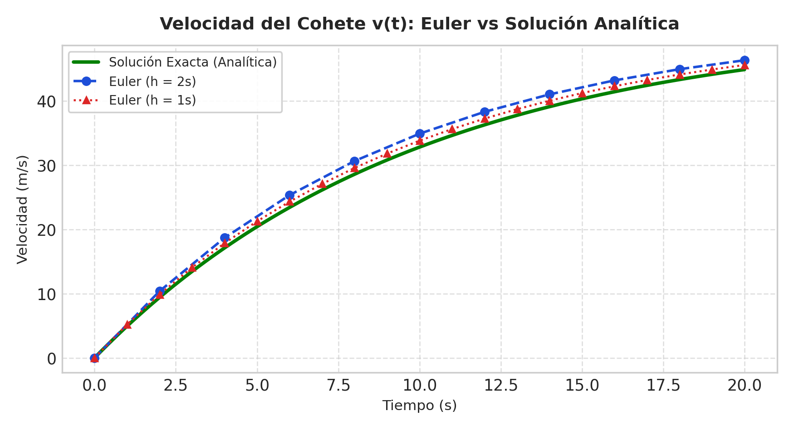
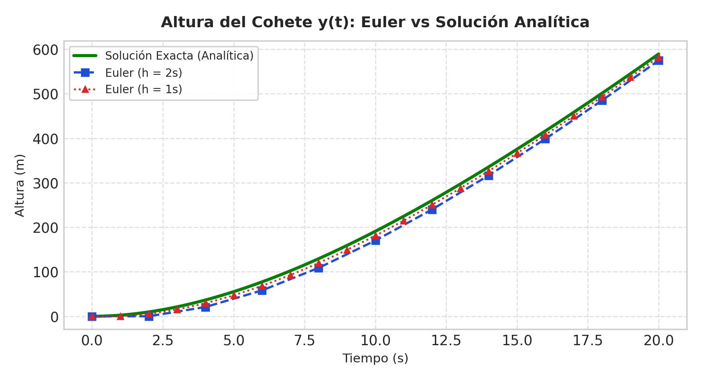
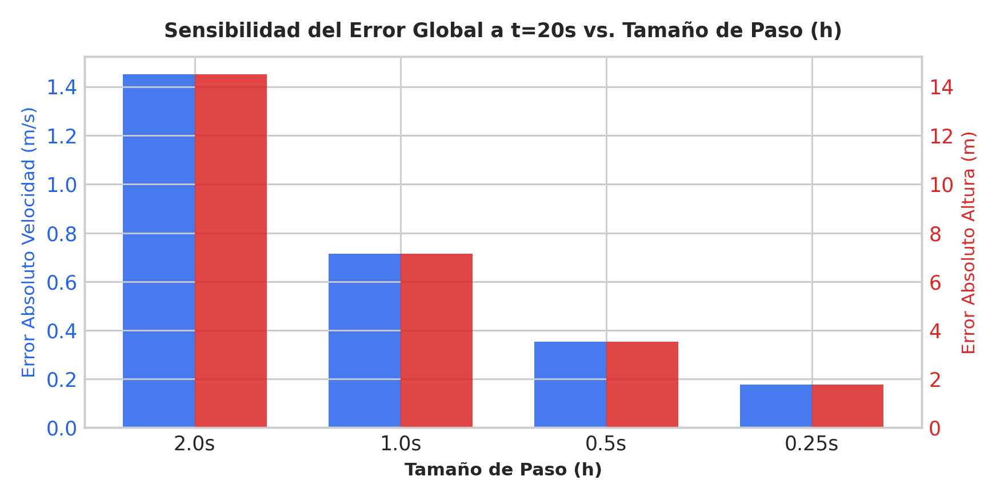

# 🚀 NASA 1962: Simulación de Ascenso de Cohete — El Método de Euler

> **Contexto Histórico:** Inspirado en el Proyecto Mercury (1962) de la NASA y la película *Talentos Ocultos / Mentes Brillantes (Hidden Figures)*, conmemorando los cálculos de trayectoria y reentrada verificados por Katherine Johnson para la misión orbital de John Glenn.

---

## 🛰️ Demostración en Vivo (GitHub Pages)

Para probar la simulación interactiva directamente en la web:
1. Activa **GitHub Pages** en la configuración de este repositorio (`Settings` > `Pages` > Seleccionar rama `main` > `/root`).
2. O clona este repositorio y abre el archivo `index.html` en cualquier navegador web moderno (no requiere servidor ni librerías externas).

---

## 📋 Descripción del Proyecto

Aplicación web interactiva que simula y analiza numéricamente el ascenso vertical de un cohete experimental durante sus primeros 20 segundos de vuelo mediante la integración de ecuaciones diferenciales ordinarias (EDO), contrastando:

1. **Método de Euler hacia adelante** (esquema de primer orden $\mathcal{O}(h)$).
2. **Método de Heun** (predictor-corrector de segundo orden $\mathcal{O}(h^2)$).
3. **Método de Runge-Kutta de 4.° Orden (RK4)** (orden superior $\mathcal{O}(h^4)$).
4. **Solución Analítica Exacta** deducida por separación de variables.

---

## ⚙️ Características de la Aplicación Web

* **Panel de Control:** Configuración de masa ($m$), empuje ($T$), gravedad ($g$), resistencia lineal del aire ($k$) y paso de integración ($h = 2.0\text{ s}, 1.0\text{ s}, 0.5\text{ s}, 0.25\text{ s}$).
* **Escenario de Simulación 2D:** Canvas animado en tiempo real con plataforma de despegue de Cabo Cañaveral, cohete con penacho de fuego y partículas, y degradado dinámico de cielo diurno a espacio exterior estrellado.
* **HUD y Telemetría en Vivo:** Reloj de misión $T+00.00\text{s}$, altitud, velocidad, aceleración neta y cálculo instantáneo del error absoluto $|E_v|$ y $|E_y|$.
* **Indicador de Seguridad NASA:** Semáforo que valida si la aproximación cumple con los estándares de vuelo tripulado ($E_v < 0.5\text{ m/s}$ y $E_y < 5.0\text{ m}$).
* **Gráficas Integradas:** Curvas sincronizadas de velocidad $v(t)$ y altitud $y(t)$ trazadas en Canvas nativo (100% offline).
* **Tabla de Iteraciones y Exportación:** Visualización paso a paso de los datos y botón para descargar el archivo `telemetria_nasa_1962_euler.csv` compatible con Excel.

---

## 📐 Modelo Físico y Matemático

Bajo la **Segunda Ley de Newton** ($\sum F = m \cdot a$):

$$m \frac{dv}{dt} = T - mg - kv \implies \frac{dv}{dt} = \frac{T}{m} - g - \frac{k}{m}v$$

Con los datos de la misión ($m = 1000\text{ kg}$, $T = 15000\text{ N}$, $g = 9.81\text{ m/s}^2$, $k = 100\text{ kg/s}$):

$$\frac{dv}{dt} = 5.19 - 0.1v, \quad v(0) = 0$$
$$\frac{dy}{dt} = v, \quad y(0) = 0$$

### Soluciones Analíticas Exactas

$$v(t) = 51.9(1 - e^{-0.1t})$$
$$y(t) = 51.9t - 519(1 - e^{-0.1t})$$

Valores teóricos exactos a $t = 20\text{ s}$:
* **Velocidad exacta:** $v(20) = 51.9(1 - e^{-2}) \approx \mathbf{44.8761\,\text{m/s}}$
* **Altitud exacta:** $y(20) = 51.9(20) - 519(1 - e^{-2}) \approx \mathbf{589.2390\,\text{m}}$

---

## 📊 Tabla Comparativa de Resultados a $t = 20\text{ s}$

| Método | Paso ($h$) | $v(20)$ (m/s) | Error $\|E_v\|$ (m/s) | $y(20)$ (m) | Error $\|E_y\|$ (m) | Criterio NASA ($E_v < 0.5$, $E_y < 5$) |
| :--- | :---: | :---: | :---: | :---: | :---: | :---: |
| **Euler Adelante** | $2.00\text{ s}$ | 46.3273 | 1.4512 | 574.7272 | 14.5118 | ❌ No Cumple (Insuficiente) |
| **Euler Adelante** | $1.00\text{ s}$ | 45.5902 | 0.7141 | 582.0983 | 7.1407 | ❌ No Cumple (Insuficiente) |
| **Euler Adelante** | $0.50\text{ s}$ | 45.2302 | 0.3541 | 585.6978 | 3.5412 | ✅ Aceptado para vuelo |
| **Euler Adelante** | $0.25\text{ s}$ | 45.0524 | 0.1763 | 587.4757 | 1.7633 | ✅ Alta precisión |
| **Heun ($\mathcal{O}(h^2)$)** | $2.00\text{ s}$ | 44.7664 | 0.1097 | 590.3355 | 1.0965 | ✅ Cumple con creces |
| **RK4 ($\mathcal{O}(h^4)$)** | $2.00\text{ s}$ | 44.8759 | **0.0002** | 589.2412 | **0.0022** | 🌟 Óptimo (Error: 2.2 mm) |
| **Solución Exacta** | Continuo | **44.8761** | **0.0000** | **589.2390** | **0.0000** | Referencia Límite |

---

## 📈 Gráficas del Comportamiento Dinámico

  
  

  

---

## 🛠️ Tecnologías Empleadas

* **HTML5 Semántico:** Estructura de cabina de control retro-aeroespacial.
* **Canvas API (2D):** Renderizado de animación en tiempo real y gráficos cartesianos de alta tasa de refresco (60 FPS).
* **JavaScript Moderno (ES6+):** Algoritmos numéricos de Euler, Heun y Runge-Kutta 4, cálculo de soluciones analíticas y exportación a formato CSV.
* **CSS3 Avanzado:** Diseño responsivo con variables CSS, estética oscura de sala de control y paneles HUD.

---

## 👤 Autor

* **Estudiante:** Oscar Valencia
* **Asignatura:** Métodos Numéricos
* **Año:** 2026
